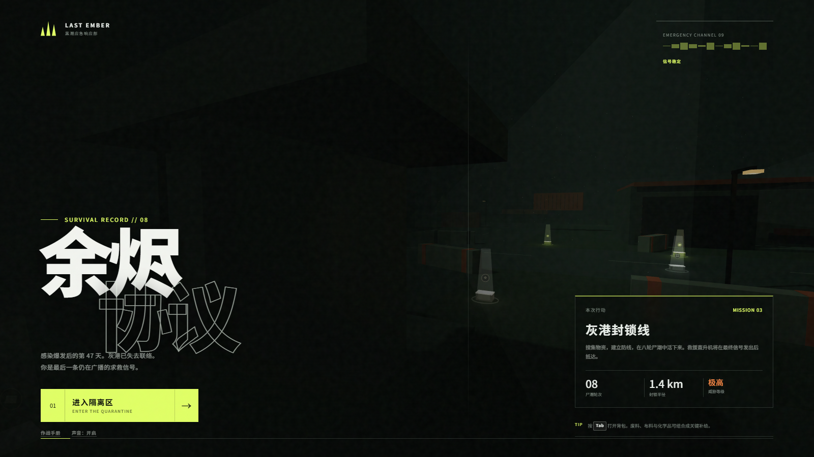
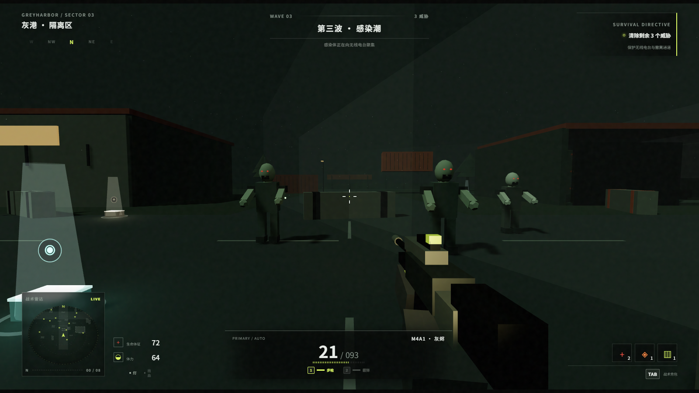
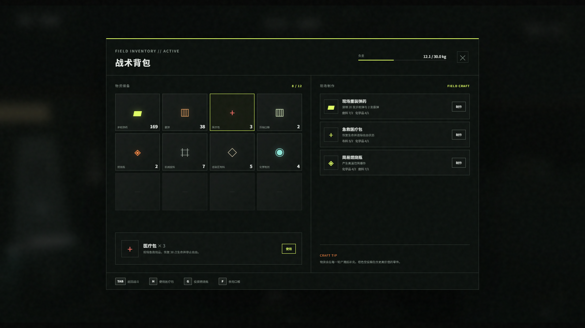
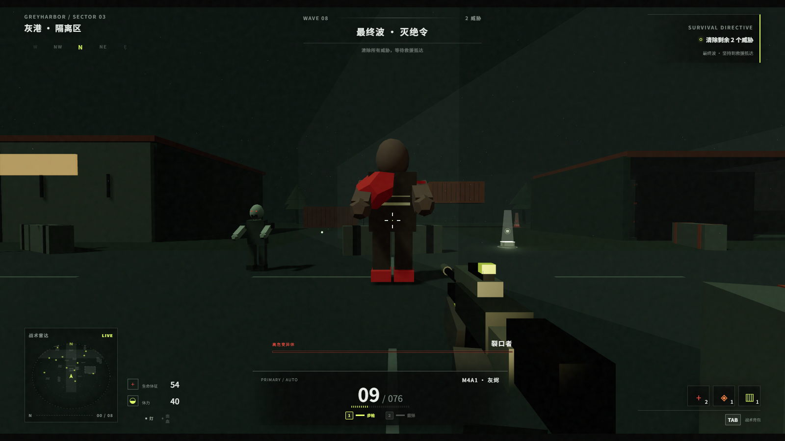
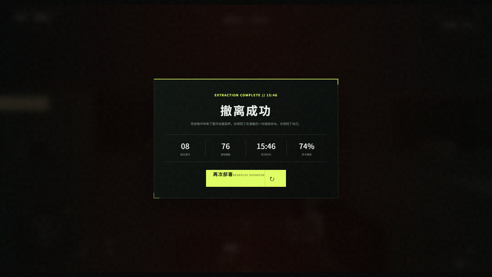
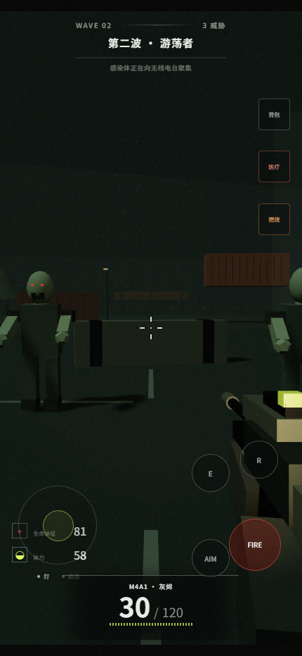

# LAST EMBER

### 余烬协议 · Grey Harbor Quarantine

**A first-person zombie survival shooter that runs directly in your browser.**

**一款可直接在浏览器中游玩的第一人称丧尸生存射击游戏。**

> Day 47. Grey Harbor has gone dark. You are the last distress signal still broadcasting.<br />
> 感染爆发后的第 47 天，灰港已失去联络。你是最后一条仍在广播的求救信号。

[](https://threejs.org/)
[](https://vite.dev/)
[](https://www.khronos.org/webgl/)
[](#technical-highlights--技术实现)



## Overview / 游戏概览

**LAST EMBER** is a compact survival FPS set inside the abandoned Grey Harbor quarantine zone. Scavenge supplies, craft ammunition and medicine, fight through eight escalating waves of infected, and hold the radio station until extraction arrives.

Explore a foggy industrial district, manage scarce resources, switch between an assault rifle and a shotgun, and make every shot count. The game supports desktop mouse-and-keyboard play as well as responsive touch controls.

**LAST EMBER（中文名：余烬协议）** 是一款完整的浏览器生存射击游戏。玩家需要在废弃的灰港隔离区中搜索物资、现场制作弹药与医疗用品、抵御八轮感染者进攻，并守住无线电台等待救援撤离。

游戏包含两种枪械、三类普通敌人、首领战、动态空投、背包制作、出血与体力系统，并兼顾桌面鼠标键盘与移动端触控操作。

## Features / 核心玩法

| Feature | English | 中文 |
| --- | --- | --- |
| FPS combat | Movement, sprinting, crouching, aiming, reloading, recoil, and headshot multipliers. | 移动、冲刺、蹲伏、瞄准、换弹、后坐力与爆头伤害。 |
| Two weapons | Full-auto assault rifle and high-impact close-range shotgun. | 全自动突击步枪与近距离高伤害霰弹枪。 |
| Eight waves | Walkers, fast runners, armored brutes, and escalating enemy pressure. | 游荡者、疾行感染者、重装变异体与逐轮升级的尸潮。 |
| Boss encounters | The Ripper appears in Wave 4 and the final assault. | “裂口者”会在第 4 波与最终波出现。 |
| Scavenging | Find ammunition, medicine, food, fuel, cloth, chemicals, and mechanical scrap. | 搜索弹药、医疗包、口粮、燃烧瓶、布料、化学品和机械废料。 |
| Field crafting | Craft rifle ammo, medical packs, and incendiary bottles from collected materials. | 使用收集到的材料制作步枪弹药、医疗包和燃烧瓶。 |
| Survival states | Health, stamina, bleeding, ammunition reserves, flashlight, and carry weight. | 生命、体力、出血、弹药储备、战术灯和负重状态。 |
| Supply drops | High-value airdrops arrive between waves and create new risk-reward decisions. | 每轮结束后刷新高价值空投，带来新的风险与收益。 |
| Atmosphere | Procedural terrain, low-poly ruins, fog, dust, emergency lighting, and a night sky. | 程序化地表、低多边形废墟、雾层、扬尘、应急灯与夜空。 |
| Audio | Gunfire, footsteps, infected growls, impacts, pickups, and explosions synthesized with Web Audio. | 枪声、脚步、低吼、命中、拾取与爆炸均由 Web Audio 实时合成。 |
| Controls | Pointer-lock desktop input, automatic mouse fallback, and mobile touch UI. | 桌面鼠标锁定、自动备用视角模式，以及移动端触控界面。 |

## Screenshots / 实机截图

### Quarantine Combat / 隔离区战斗

Grey Harbor is split by emergency lights and supply beacons. Infected emerge from ruined buildings, shipping containers, and fog.

灰港被应急灯与物资信标切开。感染者会从废弃建筑、集装箱和迷雾中接近无线电台。



### Tactical Inventory / 战术背包与现场制作

Every item has its own icon, quantity, weight, and purpose. Scrap, cloth, and chemicals can be combined into life-saving supplies at any time.

所有关键物品都有独立图标、数量、重量和用途。废料、布料与化学品可以随时组合成能救命的新物资。



### Boss Encounter / 高危首领战

The Ripper has far more health than a standard infected. Keep distance, land headshots, and use incendiary bottles wisely.

“裂口者”拥有远高于普通感染者的生命值。保持距离、命中头部并合理使用燃烧瓶，是活下来的关键。



### Extraction / 救援撤离

Survive the final wave, upload the extraction signal, and review your completed waves, total kills, survival time, and accuracy.

熬过最终波后，救援信标开始上传。行动结算会记录抵达波次、清除数量、存活时间和命中精度。



### Mobile Combat / 移动端触控

The responsive HUD keeps the essential information visible and provides a movement stick, drag-to-look area, fire, aim, reload, and quick-item actions.

响应式 HUD 会隐藏次要信息，并提供移动摇杆、拖拽视角、射击、瞄准、换弹和快捷物品按钮。

<p align="center">
  
</p>

## Play / 开始游戏

### Windows one-click / Windows 一键启动

Double-click `启动游戏.bat` in the project root. On first launch, the script installs dependencies, starts the local server, and opens the game in your browser.

双击项目根目录中的 `启动游戏.bat`。首次运行会安装依赖，随后启动本地服务器并打开浏览器。

### Manual setup / 手动启动

Requires **Node.js 20+**.

```bash
npm install
npm run dev
```

Open the local URL printed in the terminal. The latest Chrome or Edge is recommended, along with headphones for the generated audio.

打开终端显示的本地地址即可开始游戏。推荐使用最新版 Chrome 或 Edge，并建议佩戴耳机。

### Production build / 生产构建

```bash
npm run build
npm run preview
```

## Controls / 操作方式

| Action / 操作 | Input / 按键 |
| --- | --- |
| Move / 移动 | `W` `A` `S` `D` |
| Look / 观察 | Mouse / 鼠标 |
| Fire / 射击 | Left mouse / 鼠标左键 |
| Aim / 瞄准 | Right mouse / 鼠标右键 |
| Sprint / 冲刺 | `Shift` |
| Jump / 跳跃 | `Space` |
| Crouch / 蹲伏 | `C` / `Ctrl` |
| Reload / 换弹 | `R` |
| Switch weapon / 切换武器 | `1` / `2` / Mouse wheel |
| Pick up or open airdrop / 拾取或开启空投 | `E` |
| Inventory and crafting / 背包与制作 | `Tab` |
| Tactical flashlight / 战术灯 | `Q` |
| Use medical pack / 使用医疗包 | `H` |
| Eat ration / 食用口粮 | `F` |
| Throw incendiary / 投掷燃烧瓶 | `G` |
| Mute / 静音 | `M` |
| Pause / 暂停 | `Esc` / `P` |

If the browser cannot acquire pointer lock, the game switches to a fallback camera mode: hold the right mouse button to drag the view, then use the left button to fire.

如果浏览器无法锁定鼠标，游戏会自动切换到备用视角模式：按住鼠标右键拖动视角，左键射击。

## Survival Guide / 生存建议

1. **Use the preparation timer.** You have about 15 seconds before the first wave. Memorize the nearest supply beacons.
   **利用战前倒计时。** 第一波开始前约 15 秒，优先记住附近物资信标的位置。
2. **Balance consumables and materials.** Ammunition and medicine matter, but chemicals can produce both ammo and incendiary weapons.
   **平衡消耗品和材料。** 弹药与医疗包很重要，但化学品既能制作弹药，也能制作燃烧瓶。
3. **Respect fast enemies.** Runners have less health but close distance quickly and attack in rapid bursts.
   **警惕疾行感染者。** 它们生命值较低，但接近速度快、近身攻击频繁。
4. **Focus heavy targets.** Brutes and the Ripper require sustained fire. The shotgun loses damage quickly at range.
   **集中火力处理重型目标。** 霰弹枪近距离爆发高，远距离伤害衰减明显。
5. **Clear before looting.** Orange supply drops are visible from long distances and often attract threats.
   **先清场再搜刮。** 橙色空投箱视野很远，拾取前应先清理周围感染者。
6. **Treat bleeding immediately.** Medical packs restore health and stop the ongoing bleeding damage.
   **及时处理出血。** 医疗包可以同时恢复生命并停止持续伤害。

## Technical Highlights / 技术实现

- **Three.js r180**: first-person camera, low-poly environment, dynamic lighting, fog, particles, and ray-based hit detection.
- **Vanilla JavaScript**: game state machine, movement and collision, wave director, enemy AI, inventory, and crafting.
- **Vite 7**: local development and optimized production builds.
- **Web Audio API**: fully synthesized gunshots, footsteps, growls, impacts, pickups, healing, and explosions.
- **Canvas 2D**: tactical radar, minimap overlays, and procedural inventory icons.
- **Zero external game assets**: geometry, terrain textures, characters, effects, icons, and sound are generated at runtime.
- **Optimized pickups**: shared geometry, material, and icon caches prevent synchronous GPU resource disposal during collection. Overlapping drops are cleared as a cluster to eliminate visual remnants.

### Pickup regression test / 拾取回归测试

The repository includes an automated smoke test for overlapping pickups, resource rewards, prompt cleanup, and interaction latency.

仓库包含自动化冒烟测试，用于验证重叠物资清理、资源发放、交互提示消失及拾取响应速度。

```bash
# Start the development server in another terminal first.
npm run test:smoke
```

## Project Structure / 项目结构

```text
last-ember/
├─ docs/screenshots/       # Real in-game screenshots / 实机截图
├─ scripts/                # Screenshot and smoke-test automation
├─ src/
│  ├─ main.js              # Gameplay, world, AI, and Three.js scene
│  └─ style.css            # HUD, menus, and responsive layout
├─ index.html              # Game interface structure
├─ package.json
└─ 启动游戏.bat            # Windows one-click launcher
```

### Regenerate screenshots / 重新生成截图

Start the development server first, then run the following command in another terminal:

先运行开发服务器，再在另一个终端执行：

```bash
npm run screenshots
```

---

**LAST EMBER / 余烬协议**<br />
*Survive the night. Carry the last signal home.*<br />
*活过今夜，把最后的信号带回家。*
